# Development Environment Training Mission

## 1. 프로젝트 소개

코디세이 AI All-in-One 과정의 첫 번째 미션인 개발 환경 구축 실습 기록입니다.

Windows CMD에서 파일 관리 명령어를 연습하고, LabEx Linux 환경에서 파일 권한과 Docker를 실습했습니다.

Dockerfile 작성, 이미지 빌드, 웹 서버 실행, 포트 매핑, 볼륨, 바인드 마운트 및 오류 해결을 수행했습니다.
# 2. 실습 환경

| 구분 | 실습 환경 |
|---|---|
| 운영체제 | Windows 및 LabEx Linux |
| Windows 터미널 | CMD, VS Code PowerShell |
| Linux 실습 | LabEx Docker Playground |
| Linux 작업 경로 | /home/labex/project/my-web |
| Docker 버전 | 20.10.21 |
| 코드 편집기 | Visual Studio Code |
| Git 버전 | 2.56.0.windows.4 |
| GitHub 저장소 | https://github.com/haru1208/1029_cs |

### 환경 선택 이유

초기 공용 PC에서는 Docker 명령어가 인식되지 않았습니다.

따라서 Windows에서는 파일 관리 및 Git 실습을 진행하고, LabEx 온라인 Linux 환경에서 Docker 이미지 빌드와 컨테이너 실습을 수행했습니다.

LabEx는 임시 환경이므로 Dockerfile, index.html, 실습 스크린샷 및 볼륨 백업 파일을 개인 컴퓨터에도 보관했습니다.

## 3. 실습 완료 체크리스트

- [x] Windows CMD 기본 명령어 실습
- [x] 파일 생성, 확인, 복사, 이동 및 삭제
- [x] 절대 경로와 상대 경로 이해
- [x] Linux 파일 및 디렉터리 권한 변경
- [x] chmod 644, 700, 755 실습
- [x] Docker 버전 및 데몬 상태 확인
- [x] Docker hello-world 실행
- [x] Docker 이미지와 컨테이너 목록 확인
- [x] Dockerfile 직접 작성
- [x] 사용자 지정 Docker 이미지 빌드
- [x] Docker 웹 서버 실행 및 포트 매핑
- [x] curl 명령어로 웹 서버 응답 확인
- [x] Docker 볼륨 생성 및 데이터 보존 확인
- [x] Docker 볼륨 백업 및 파일 검증
- [x] Docker 바인드 마운트 실습
- [x] Docker 포트 충돌 재현 및 해결
- [x] VS Code 및 Git 설치
- [x] 로컬 Git 저장소 초기화
- [x] 기존 GitHub 저장소 연결 및 변경 이력 확인
- [x] 최종 README 및 실습 파일 커밋
- [x] 최종 Git 커밋 및 GitHub 업로드
- [x] 코디세이 AI 재평가 결과 확인 (18/18 PASS, 100%)


## 4. Windows CMD 파일 관리 실습

### 4.1 작업 폴더 및 기본 명령어

개인 Windows 컴퓨터의 다음 폴더에서 실습했습니다.

`C:\codyssey-mission`

실행한 명령어:

```cmd
dir
dir /a
cd archive
cd ..
cd \
cd /d C:\codyssey-mission
```

명령어 설명:

- `dir`: 현재 폴더의 파일과 폴더 확인
- `dir /a`: 숨김 항목을 포함한 목록 확인
- `cd`: 폴더 이동
- `cd ..`: 상위 폴더로 이동
- `cd \`: 현재 드라이브의 최상위 폴더로 이동
- `cd /d`: 드라이브 변경을 포함한 폴더 이동

### 4.2 파일 생성 및 확인

```cmd
echo [1] 현재 경로 확인: C:\codyssey-mission > terminal_log.txt
type terminal_log.txt
```

`echo`로 파일을 만들고 `type`으로 저장된 내용을 확인했습니다.

- `>`: 파일 내용을 새로 작성하거나 덮어쓰기
- `>>`: 기존 내용을 유지하면서 추가하기

### 4.3 파일 복사 및 이동

```cmd
copy terminal_log.txt terminal_log_backup.txt
mkdir archive
move terminal_log_backup.txt archive\my_log.txt
dir /s
```

`copy`로 백업 파일을 생성했습니다.

`mkdir`로 만든 `archive` 폴더에 `move` 명령어로 파일을 이동했습니다.

`dir /s`로 하위 폴더의 파일까지 확인했습니다.

### 4.4 파일 삭제

```cmd
echo 삭제 연습용 파일입니다. > delete_test.txt
dir delete_test.txt
del delete_test.txt
dir
```

삭제용 파일을 만든 다음 `del`로 삭제했습니다.

마지막으로 `dir`을 실행해 파일이 사라졌는지 확인했습니다.

### 4.5 절대 경로와 상대 경로

**절대 경로**는 현재 위치와 관계없이 파일의 전체 위치를 나타냅니다.

예시:

`C:\codyssey-mission\my-web\Dockerfile`

**상대 경로**는 현재 작업 폴더를 기준으로 위치를 나타냅니다.

예시:

`archive\my_log.txt`

- `.`: 현재 폴더
- `..`: 상위 폴더

### 4.6 실습 결과

이번 실습을 통해 Windows CMD에서 파일 생성, 내용 확인, 복사, 이동 및 삭제를 수행했습니다.

실습 결과는 `terminal_log.txt`와 `archive/my_log.txt`에 보관했습니다.


## 5. Linux 파일 및 디렉터리 권한 실습

### 5.1 Linux 기본 명령어

LabEx Linux 터미널에서 다음 명령어를 실행했습니다.

```bash
pwd
whoami
ls
ls -a
```

실습 결과:
- `pwd`: `/home/labex/project`
- `whoami`: `labex`
- `ls`: 파일 및 폴더 목록 확인
- `ls -a`: 숨김 파일까지 확인

### 5.2 파일 권한 변경 (644)

```bash
touch permission_test.txt
ls -l permission_test.txt
chmod 644 permission_test.txt
ls -l permission_test.txt
```

확인한 권한:

```text
-rw-r--r--
```

Linux 권한의 숫자는 다음과 같이 계산합니다.

- 읽기(Read, r) = 4
- 쓰기(Write, w) = 2
- 실행(Execute, x) = 1

따라서 `644`는 다음과 같습니다.

- 소유자: 6 = 4 + 2 → 읽기, 쓰기
- 그룹: 4 → 읽기
- 기타 사용자: 4 → 읽기

파일 생성 직후에도 권한이 644였기 때문에, 이번 실습에서는 `chmod 644` 실행 후 동일한 권한이 유지되는 것을 확인했습니다.

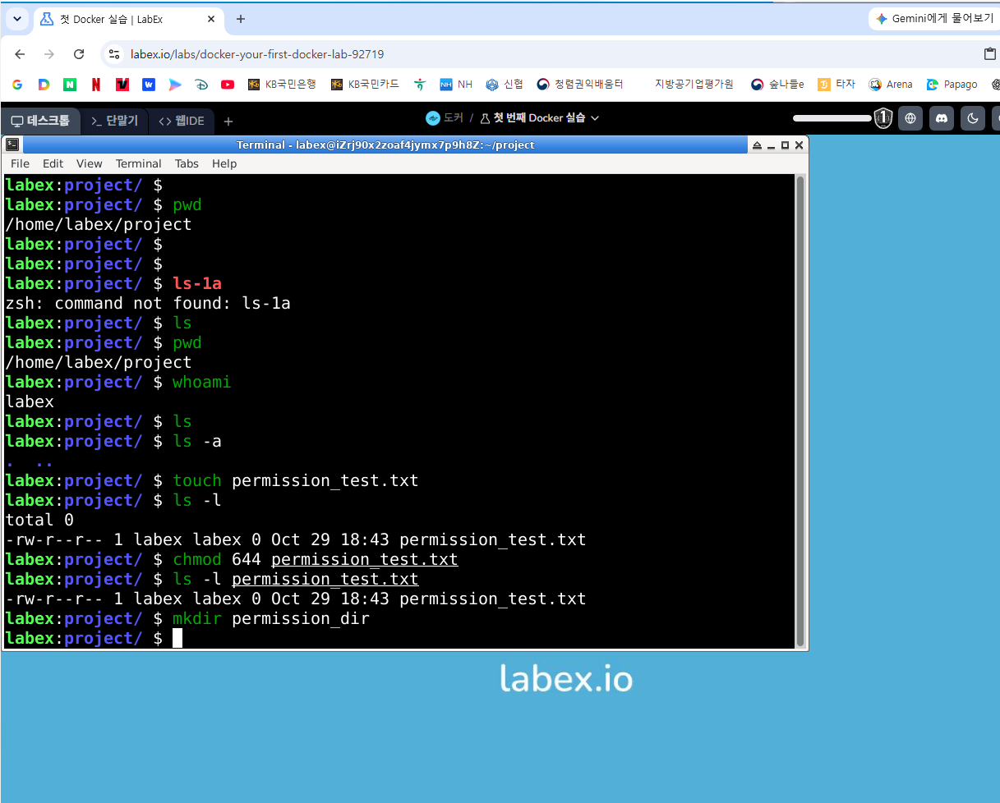

### 5.3 디렉터리 권한 변경 (700, 755)

```bash
mkdir permission_dir
ls -ld permission_dir
chmod 700 permission_dir
ls -ld permission_dir
chmod 755 permission_dir
ls -ld permission_dir
```

700 적용 결과:

```text
drwx------
```

755 적용 결과:

```text
drwxr-xr-x
```

**700의 의미**

- 소유자: 읽기, 쓰기, 실행
- 그룹: 권한 없음
- 기타 사용자: 권한 없음

**755의 의미**

- 소유자: 7 = 4 + 2 + 1 → 읽기, 쓰기, 실행
- 그룹: 5 = 4 + 1 → 읽기, 실행
- 기타 사용자: 5 = 4 + 1 → 읽기, 실행

파일의 실행 권한은 프로그램 실행과 관련이 있고, 디렉터리의 실행 권한은 해당 경로에 접근하는 데 필요합니다.

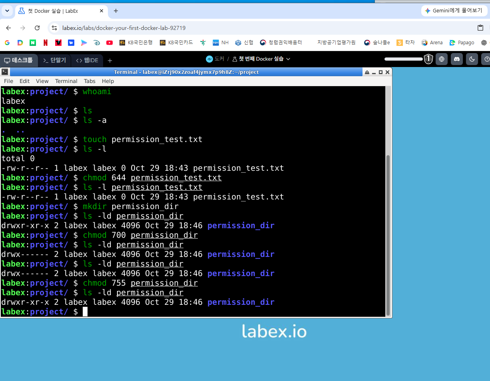

### 5.4 Windows와 Linux 권한의 차이

Windows CMD에서는 `attrib` 명령어로 읽기 전용 등의 파일 속성을 제어할 수 있습니다.

Linux에서는 `chmod` 명령어로 소유자, 그룹, 기타 사용자의 읽기·쓰기·실행 권한을 설정합니다.

두 명령어는 서로 다른 운영체제의 권한 및 속성 관리 방식이며, 기능이 완전히 같지는 않습니다.

### 5.5 실습 결과

Linux에서 파일과 디렉터리의 권한을 조회하고 변경했습니다.

특히 디렉터리의 권한을 700으로 제한한 뒤 755로 다시 변경하면서 권한 문자열이 실제로 달라지는 것을 확인했습니다.


## 6. Docker 실행 환경 및 기본 명령어

### 6.1 Docker 버전 확인

LabEx Linux 터미널에서 다음 명령어를 실행했습니다.

```bash
docker --version
```

확인 결과:

```text
Docker version 20.10.21
```

### 6.2 Docker 데몬 상태 확인

```bash
docker info
```

Docker 서버 정보가 정상적으로 출력되는 것을 확인했습니다.

- Docker 클라이언트: 명령어를 전달하는 프로그램
- Docker 데몬: 이미지 생성 및 컨테이너 실행을 관리하는 서버 프로세스
- `docker info`: 클라이언트와 Docker 서버의 연결 상태 및 환경 정보 확인

공용 Windows PC에서는 Docker 명령어를 인식하지 못했지만, LabEx Linux에서는 Docker 서버와 정상적으로 통신했습니다.

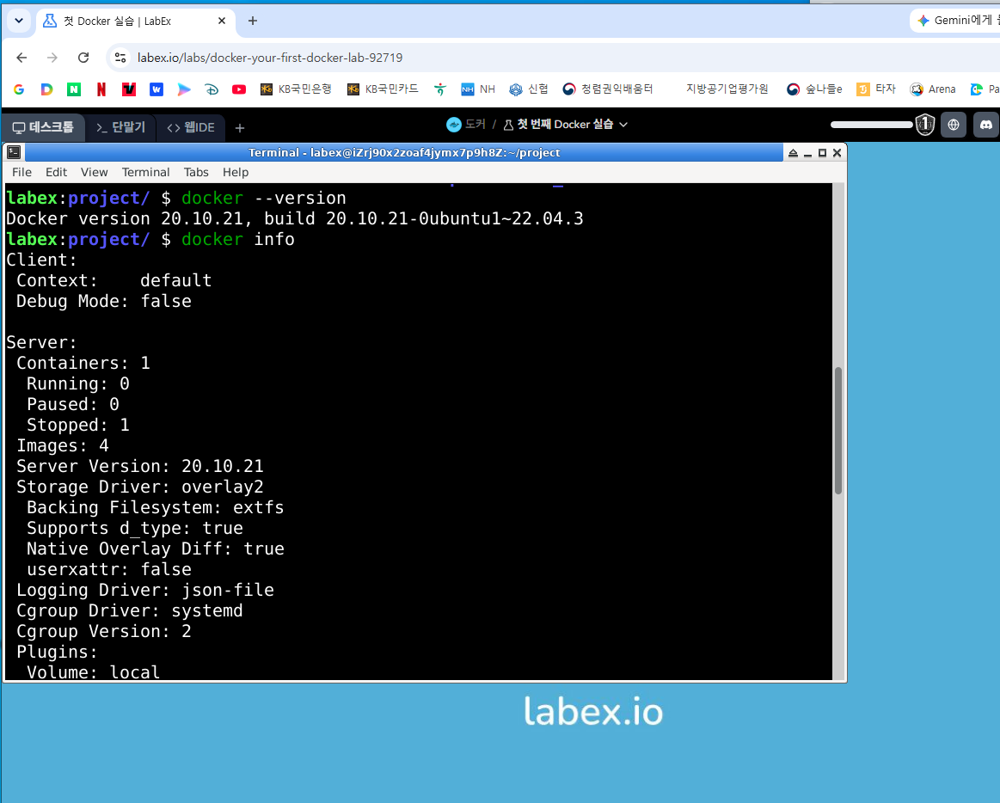

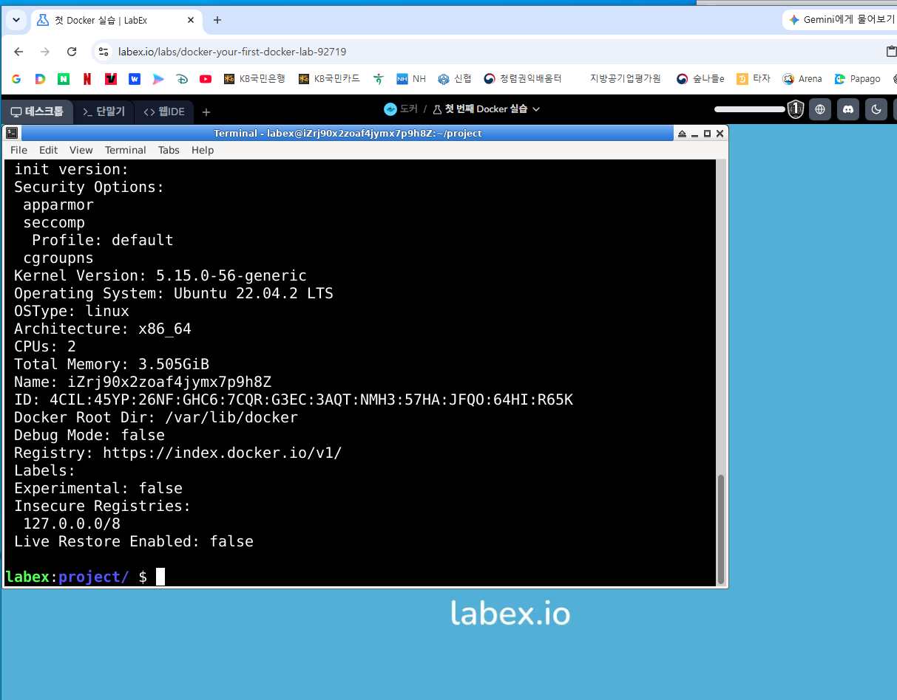

### 6.3 hello-world 컨테이너 실행

```bash
docker run hello-world
```

실행 결과:

```text
Hello from Docker!
```

기본 Docker 이미지를 사용해 컨테이너를 실행하는 데 성공했습니다.

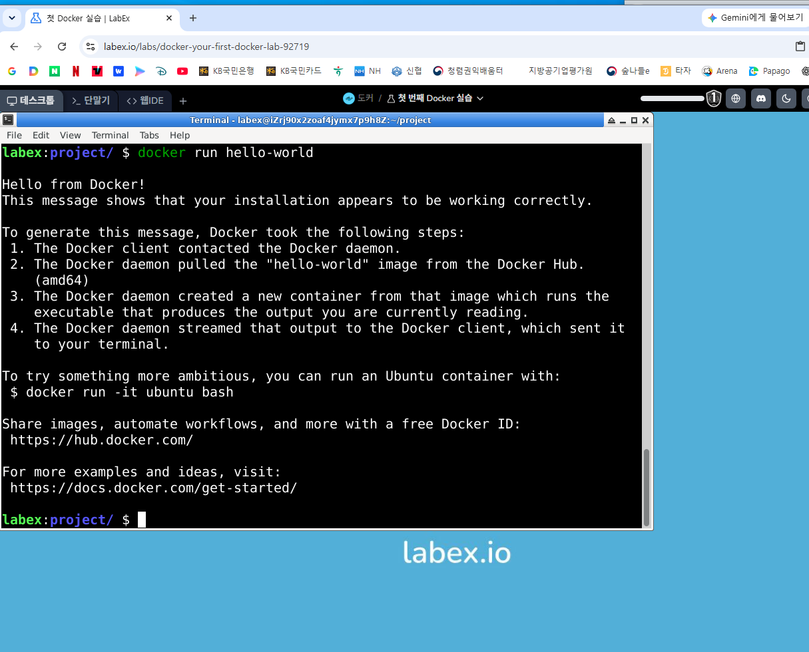

### 6.4 Docker 이미지와 컨테이너 목록 확인

```bash
docker ps
docker ps -a
docker images
```

각 명령어의 의미:

- `docker ps`: 현재 실행 중인 컨테이너 확인
- `docker ps -a`: 종료된 컨테이너까지 포함해 확인
- `docker images`: 로컬에 저장된 이미지 목록 확인

`hello-world` 컨테이너가 `Exited (0)` 상태로 표시되는 것을 확인했습니다. 이는 컨테이너가 작업을 정상적으로 마치고 종료됐다는 뜻입니다.

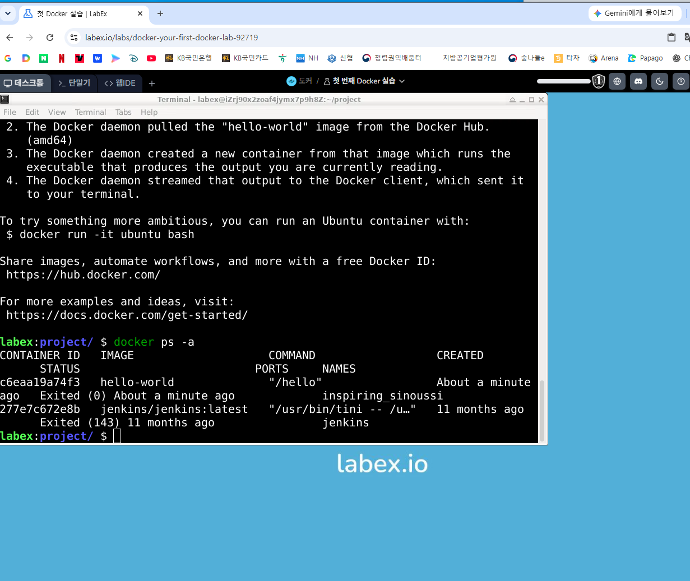

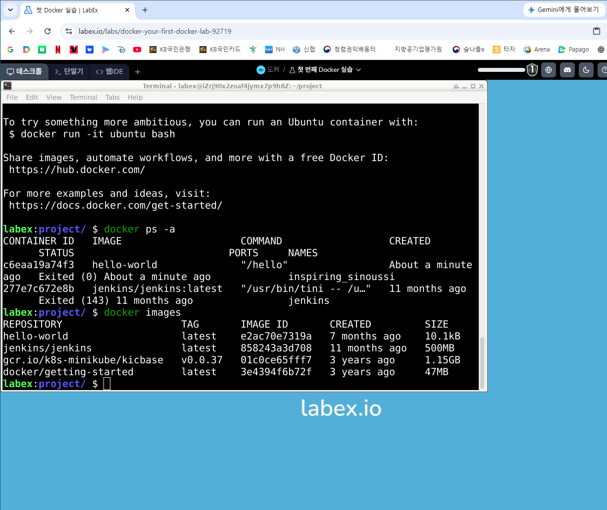

### 6.5 Docker 이미지와 컨테이너의 차이

**이미지(Image)**는 프로그램 실행에 필요한 파일과 설정이 담긴 템플릿입니다.

**컨테이너(Container)**는 이미지를 기반으로 생성되어 실제로 실행되는 환경입니다.

예를 들어 `codyssey-web:1.0` 이미지 하나를 이용해 `codyssey-test`와 `port-conflict-test`라는 서로 다른 컨테이너를 만들었습니다.

이미지와 컨테이너는 서로 다르며, 같은 이미지에서 여러 컨테이너를 생성할 수 있습니다.

### 6.6 실습 결과

Docker 버전과 데몬 상태를 확인하고, `hello-world` 실행 및 이미지·컨테이너 목록 조회까지 완료했습니다.


## 7. Dockerfile 작성 및 이미지 빌드

### 7.1 웹 프로젝트 생성

LabEx Linux에서 `my-web` 폴더를 생성했습니다.

```bash
mkdir my-web
cd my-web
```

웹페이지 파일인 `index.html`을 만들었습니다.

```bash
echo "Hello Codyssey! My First Docker Web Server" > index.html
cat index.html
```

확인 결과:

```text
Hello Codyssey! My First Docker Web Server
```

### 7.2 Dockerfile 직접 작성

Dockerfile은 Docker 이미지를 만드는 데 필요한 명령어를 순서대로 작성한 파일입니다.

처음에는 `nginx:alpine` 이미지를 사용하려 했으나, Docker Hub 연결 시간 초과로 다운로드에 실패했습니다.

이후 LabEx에 이미 저장되어 있던 `docker/getting-started:latest` 이미지를 사용했습니다.

최종 Dockerfile 내용:

```dockerfile
FROM docker/getting-started:latest
COPY index.html /usr/share/nginx/html/index.html
```

명령어 의미:

- `FROM`: 사용할 기본 이미지 지정
- `COPY`: 직접 만든 파일을 Docker 이미지 내부에 복사
- `/usr/share/nginx/html/index.html`: 웹 서버에서 제공할 페이지 파일 경로

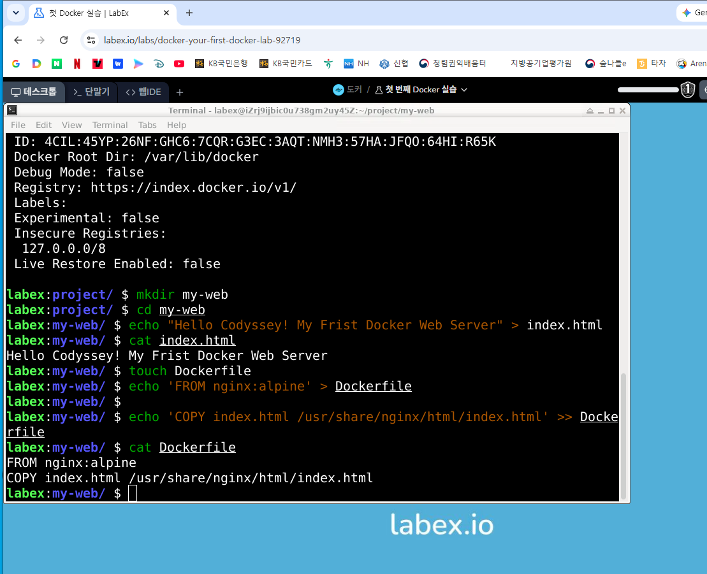

### 7.3 Docker 이미지 빌드

다음 명령어로 직접 작성한 Dockerfile을 이용해 이미지를 빌드했습니다.

```bash
docker build -t codyssey-web:1.0 .
```

명령어 설명:

- `docker build`: Docker 이미지 생성
- `-t`: 이미지 이름과 태그 지정
- `codyssey-web`: 이미지 이름
- `1.0`: 이미지 태그
- `.`: 현재 작업 폴더를 빌드 컨텍스트로 사용

빌드 성공 결과:

```text
Successfully built c03adf66e8d5
Successfully tagged codyssey-web:1.0
```

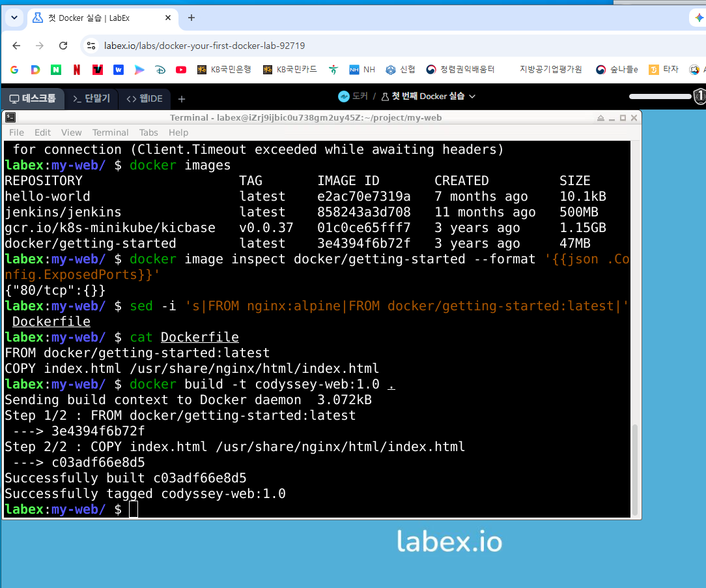

### 7.4 생성한 이미지 확인

```bash
docker images codyssey-web
```

실행 결과 `codyssey-web` 이미지와 `1.0` 태그가 표시되는 것을 확인했습니다.

### 7.5 실습 중 발생한 문제와 해결

**문제:** `nginx:alpine` 이미지를 다운로드하지 못해 처음 빌드에 실패했습니다.

**오류 메시지:**

```text
Client.Timeout exceeded while awaiting headers
```

**원인 분석:** Docker Hub에서 이미지 정보를 가져오는 과정에서 연결 시간 초과가 발생했습니다. 정확한 네트워크 차단 원인은 확정하지 못했습니다.

**해결 과정:**

1. `docker images`로 로컬에 저장된 이미지 목록 확인
2. 기존 `docker/getting-started` 이미지 확인
3. Dockerfile의 `FROM`을 해당 이미지로 변경
4. `docker build` 재실행

**결과:** `codyssey-web:1.0` 이미지 빌드에 성공했습니다.

### 7.6 다른 환경에서 재현할 때 주의사항

이번 실습에서는 기본 이미지가 LabEx에 이미 저장되어 있어 빌드할 수 있었습니다.

다른 환경에서는 Docker Hub 연결이 필요할 수 있습니다. 또한 `latest` 태그의 이미지 내용은 변경될 수 있으므로, 재현성을 높이려면 특정 이미지 버전을 고정하는 것이 좋습니다.

### 7.7 실습 결과

Dockerfile을 직접 작성하고, 다운로드 오류를 해결한 후 사용자 지정 Docker 이미지를 빌드하는 데 성공했습니다.


## 8. Docker 웹 서버 실행 및 포트 매핑

### 8.1 사용자 지정 컨테이너 실행

앞에서 직접 빌드한 `codyssey-web:1.0` 이미지를 이용해 웹 서버 컨테이너를 실행했습니다.

```bash
docker run -d --name codyssey-test -p 8080:80 codyssey-web:1.0
```

명령어 설명:

- `docker run`: 이미지에서 새 컨테이너를 생성하고 실행
- `-d`: 백그라운드에서 실행
- `--name codyssey-test`: 컨테이너 이름 지정
- `-p 8080:80`: 호스트의 8080번 포트를 컨테이너의 80번 포트에 연결
- `codyssey-web:1.0`: 직접 빌드한 이미지 사용

명령어 실행 후 긴 영문·숫자로 구성된 컨테이너 ID가 출력됐습니다.

### 8.2 컨테이너 실행 상태 확인

```bash
docker ps
```

확인 결과:

- 이미지: `codyssey-web:1.0`
- 컨테이너 이름: `codyssey-test`
- 실행 상태: `Up`
- 포트 연결: `0.0.0.0:8080->80/tcp`

`Up`은 컨테이너가 실행 중이라는 뜻입니다.

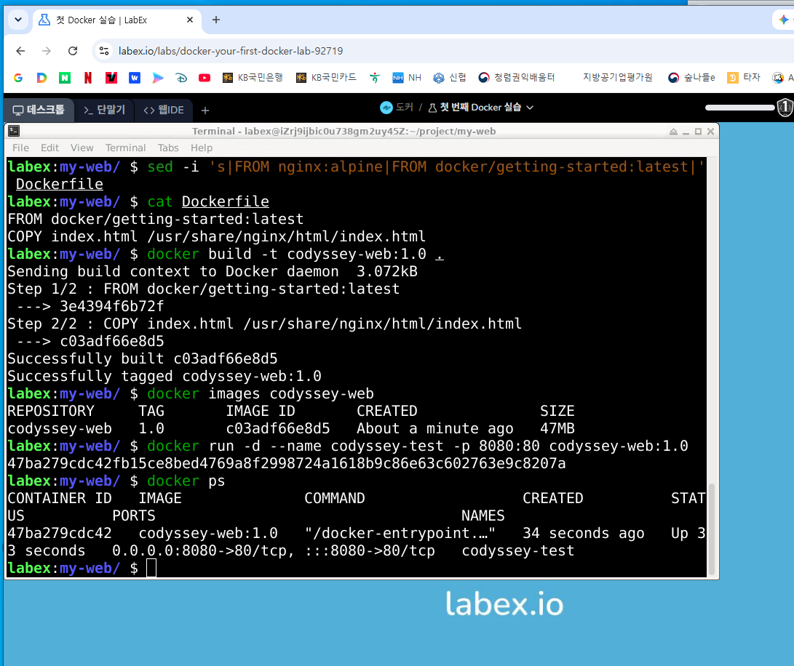

### 8.3 웹페이지 접속 확인

```bash
curl http://localhost:8080
```

실제 출력 결과:

```text
Hello Codyssey! My First Docker Web Server
```

`curl`을 이용해 웹 서버에 HTTP 요청을 보내고 직접 작성한 `index.html`의 내용이 반환되는 것을 확인했습니다.

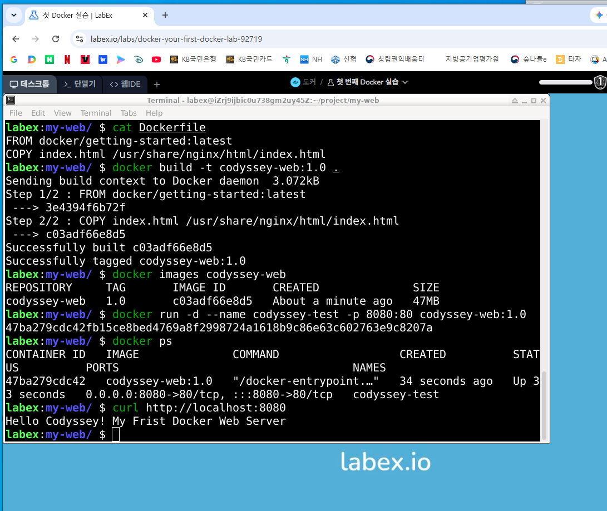

### 8.4 포트 매핑의 원리

Docker 컨테이너는 독립된 네트워크 환경을 사용할 수 있습니다.

컨테이너 내부에서 웹 서버가 80번 포트로 실행되더라도, 호스트에서 접근하려면 해당 포트로 연결되는 경로가 필요합니다.

```text
LabEx 호스트 컴퓨터
        |
        | localhost:8080
        v
호스트 8080번 포트
        |
        | Docker 포트 매핑
        v
컨테이너 80번 포트
        |
        v
NGINX 웹 서버
        |
        v
index.html
```

`-p 8080:80`의 의미:

- 앞의 `8080`: 호스트 포트
- 뒤의 `80`: 컨테이너 내부 포트

즉, 호스트의 8080번 포트로 들어온 요청을 컨테이너의 80번 포트에 전달합니다.

### 8.5 컨테이너 네트워크 격리

서로 다른 Docker 컨테이너는 내부에서 같은 80번 포트를 사용할 수 있습니다.

그러나 같은 호스트 IP 주소의 8080번 포트를 두 컨테이너가 동시에 점유하도록 설정하면 포트 충돌이 발생합니다.

예를 들어:

- 첫 번째 컨테이너: `8080:80`
- 두 번째 컨테이너: `8081:80`

두 컨테이너는 내부 포트 80을 사용하면서도 호스트 포트가 다르므로 함께 실행할 수 있습니다.

단, 컨테이너 간 네트워크 접근 가능 여부는 Docker 네트워크 설정에 따라 달라집니다.

### 8.6 컨테이너 로그 및 중지

웹 서버의 로그를 확인할 때 사용한 명령어:

```bash
docker logs web-test
```

컨테이너를 중지할 때 사용한 명령어:

```bash
docker stop web-test
```

이 명령어들은 처음에 `docker/getting-started` 이미지로 실행했던 `web-test` 컨테이너에서 실습했습니다.

`docker stop`은 컨테이너를 중지하지만 삭제하지는 않습니다.

### 8.7 실습 결과

직접 만든 Docker 이미지를 이용해 웹 서버 컨테이너를 실행했습니다.

`docker ps`로 실행 상태와 포트 매핑을 확인하고, `curl`로 실제 웹페이지 응답을 검증했습니다.

이를 통해 Docker 컨테이너의 내부 포트와 호스트 포트가 서로 다른 역할을 한다는 점을 이해했습니다.


## 9. Docker 볼륨 및 데이터 영속성 실습

### 9.1 Docker 볼륨이란?

Docker 볼륨(Volume)은 컨테이너와 별도로 데이터를 저장하기 위한 Docker 관리형 저장 공간입니다.

컨테이너를 중지하거나 삭제하더라도 볼륨을 별도로 삭제하지 않으면 저장된 데이터를 유지할 수 있습니다.

### 9.2 볼륨 생성 및 목록 확인

LabEx Linux 터미널에서 다음 명령어를 실행했습니다.

```bash
docker volume create codyssey-data
docker volume ls
```

생성된 `codyssey-data` 볼륨이 목록에 표시되는 것을 확인했습니다.

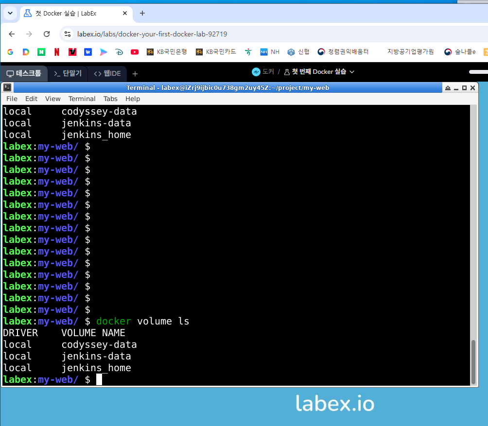

### 9.3 볼륨에 데이터 저장하기

```bash
docker run --rm -v codyssey-data:/data docker/getting-started sh -c 'echo "Codyssey volume test" > /data/test.txt'
```

명령어 설명:

- `docker run`: 새로운 컨테이너 실행
- `--rm`: 작업 완료 후 임시 컨테이너 자동 삭제
- `-v codyssey-data:/data`: 볼륨을 컨테이너의 `/data` 폴더에 연결
- `sh -c`: 컨테이너 안에서 명령어 실행
- `echo`: 테스트 문장을 `test.txt`에 기록

### 9.4 데이터 영속성 확인

첫 번째 임시 컨테이너가 삭제된 후 새로운 임시 컨테이너에서 같은 볼륨의 파일을 읽었습니다.

```bash
docker run --rm -v codyssey-data:/data docker/getting-started cat /data/test.txt
```

실제 출력 결과:

```text
Codyssey volume test
```

새 컨테이너에서도 동일한 내용이 출력됐습니다.

따라서 **컨테이너를 삭제해도 Docker 볼륨의 데이터는 유지된다**는 것을 확인했습니다.


### 9.5 볼륨 상세 정보 확인

```bash
docker volume inspect codyssey-data
```

확인 항목:

- `Name`: 볼륨 이름
- `Driver`: 저장소 관리 방식
- `Mountpoint`: Docker가 관리하는 실제 저장 경로

이번 실습의 볼륨은 `local` 드라이버를 사용했습니다.

### 9.6 볼륨 데이터 백업

볼륨의 데이터를 압축 파일로 백업했습니다.

```bash
docker run --rm -v codyssey-data:/data -v "$PWD":/backup docker/getting-started tar -czf /backup/codyssey-backup.tar.gz -C /data .
```

명령어 설명:

- `codyssey-data:/data`: 백업할 Docker 볼륨
- `"$PWD":/backup`: 현재 LabEx 작업 폴더를 백업 저장 위치로 연결
- `tar -czf`: 파일을 gzip 형식으로 압축
- `codyssey-backup.tar.gz`: 생성한 백업 파일 이름

백업 파일 생성 확인:

```bash
ls -lh codyssey-backup.tar.gz
```

압축 파일 내부 확인:

```bash
tar -tzf codyssey-backup.tar.gz
```

실제 출력 결과:

```text
./
./test.txt
```

압축 파일 안에 `test.txt`가 들어 있는 것을 확인했습니다.

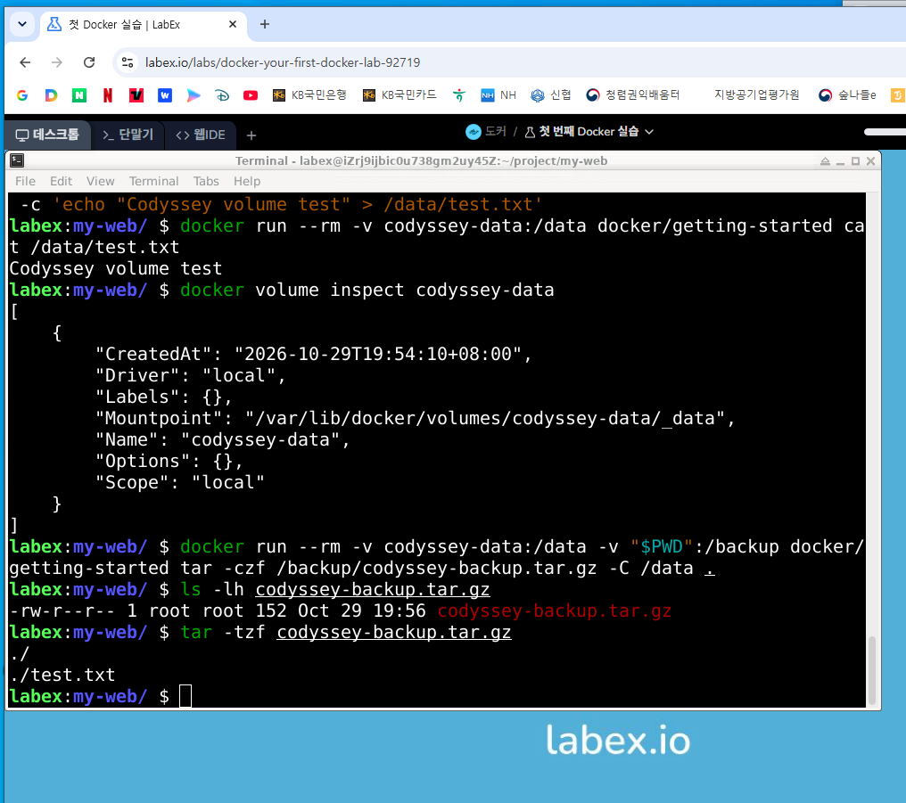

### 9.7 백업 파일 보관

LabEx 웹IDE의 다운로드 기능을 이용해 `codyssey-backup.tar.gz`를 집 컴퓨터로 다운로드했습니다.

다운로드한 파일은 다음 위치에 보관했습니다.

```text
C:\codyssey-mission\codyssey-backup.tar.gz
```

이 파일은 Docker 볼륨 데이터 백업 실습의 결과물입니다.

### 9.8 볼륨 복원 방법

다음은 별도의 볼륨에 백업 파일을 복원하는 방법입니다.

**주의: 아래 복원 명령어는 재현 절차를 정리한 것이며, 이번 실습에서 직접 실행해 성공 여부를 확인한 것은 아닙니다.**

새 볼륨 생성:

```bash
docker volume create codyssey-restored
```

백업 파일 복원:

```bash
docker run --rm -v codyssey-restored:/data -v "$PWD":/backup docker/getting-started tar -xzf /backup/codyssey-backup.tar.gz -C /data
```

복원된 파일 확인:

```bash
docker run --rm -v codyssey-restored:/data docker/getting-started cat /data/test.txt
```

정상적으로 복원됐다면 `Codyssey volume test`가 출력됩니다.

### 9.9 실습 결과

이번 실습을 통해 Docker 볼륨 생성, 파일 저장, 다른 컨테이너에서 데이터 확인, 백업 파일 생성 및 압축 내용 확인까지 수행했습니다.

컨테이너와 별도의 저장 공간을 이용하면 컨테이너가 삭제되더라도 중요한 데이터를 유지할 수 있음을 확인했습니다.


## 10. Docker 바인드 마운트 실습

### 10.1 바인드 마운트란?

바인드 마운트(Bind Mount)는 호스트 컴퓨터에 있는 파일이나 폴더를 Docker 컨테이너 내부의 경로에 직접 연결하는 기능입니다.

호스트에서 파일을 수정하면 컨테이너에서도 변경된 내용을 확인할 수 있습니다.

### 10.2 실습용 폴더와 파일 생성

LabEx Linux에서 다음 명령어를 실행했습니다.

```bash
mkdir bind-test
echo "Hello Bind Mount" > bind-test/hello.txt
```

생성한 파일 구조:

```text
my-web/
└── bind-test/
    └── hello.txt
```

### 10.3 컨테이너에서 파일 읽기

```bash
docker run --rm -v "$PWD/bind-test:/data" docker/getting-started cat /data/hello.txt
```

명령어 설명:

- `--rm`: 작업이 끝나면 임시 컨테이너 삭제
- `-v`: 호스트 폴더와 컨테이너 경로 연결
- `$PWD/bind-test`: 호스트의 `bind-test` 폴더
- `/data`: 컨테이너 내부의 연결 경로
- `cat`: 컨테이너에서 파일 내용 확인

실제 출력 결과:

```text
Hello Bind Mount
```

호스트에 만든 파일을 컨테이너에서도 읽을 수 있다는 것을 확인했습니다.

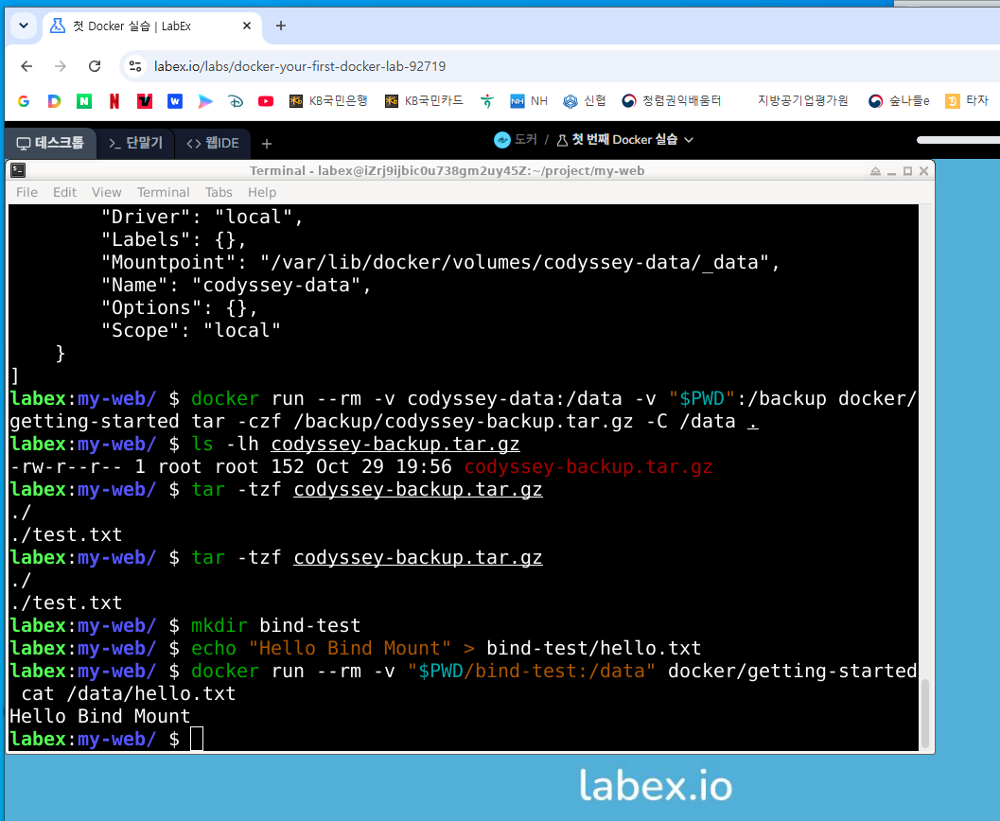

### 10.4 파일 변경 사항 확인

호스트에서 파일 내용을 변경했습니다.

```bash
echo "Bind Mount Updated!" > bind-test/hello.txt
```

그다음 새로운 컨테이너에서 같은 파일을 읽었습니다.

```bash
docker run --rm -v "$PWD/bind-test:/data" docker/getting-started cat /data/hello.txt
```

실제 출력 결과:

```text
Bind Mount Updated!
```

호스트에서 수정한 내용이 컨테이너에서도 반영되는 것을 확인했습니다.

이번 실습에서는 새로운 임시 컨테이너를 실행해 확인했으며, 하나의 컨테이너를 계속 실행한 상태에서 변경 과정을 관찰한 것은 아닙니다.

### 10.5 Docker 볼륨과 바인드 마운트 비교

| 비교 항목 | Docker 볼륨 | 바인드 마운트 |
|---|---|---|
| 저장 위치 | Docker가 관리 | 호스트 사용자가 지정 |
| 연결 방식 | 볼륨 이름 사용 | 호스트 파일 또는 폴더 경로 사용 |
| 주요 용도 | 데이터베이스, 영구 데이터 보관 | 개발 파일 공유, 설정 파일 연결 |
| 컨테이너 삭제 시 | 볼륨을 별도로 삭제하지 않으면 데이터 유지 | 호스트 파일이 남아 있으면 데이터 유지 |
| 백업 방식 | 볼륨 데이터를 별도로 백업 | 호스트 파일을 직접 백업 가능 |

### 10.6 실습 결과

Docker 볼륨은 컨테이너와 별도로 데이터를 저장하는 데 사용했고, 바인드 마운트는 호스트 파일을 컨테이너와 공유하는 데 사용했습니다.

두 방식 모두 컨테이너 외부의 데이터를 활용하지만, 저장 위치를 관리하는 주체와 사용 목적이 다르다는 점을 이해했습니다.


## 11. Docker 포트 충돌 및 해결 실습

### 11.1 문제 발생 상황

기존에 실행한 `codyssey-test` 컨테이너가 호스트의 8080번 포트를 사용하고 있었습니다.

```bash
docker ps
```

기존 컨테이너 상태:

- 이름: `codyssey-test`
- 이미지: `codyssey-web:1.0`
- 상태: `Up`
- 포트: `8080->80/tcp`

이 상태에서 새로운 컨테이너도 호스트의 8080번 포트를 사용하도록 실행했습니다.

```bash
docker run -d --name port-conflict-test -p 8080:80 codyssey-web:1.0
```

### 11.2 실제 오류 메시지

```text
Bind for 0.0.0.0:8080 failed: port is already allocated.
```

이는 호스트의 8080번 포트가 이미 다른 컨테이너에 할당되어 있다는 뜻입니다.

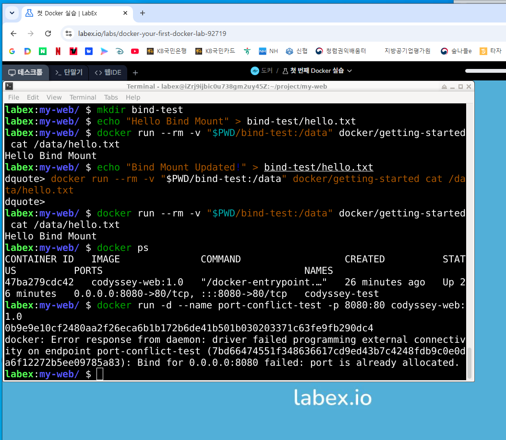

### 11.3 문제 원인 분석

Docker 컨테이너는 서로 독립된 네트워크 환경에서 같은 내부 포트를 사용할 수 있습니다.

하지만 동일한 호스트 IP 주소의 같은 포트를 두 컨테이너가 동시에 점유할 수는 없습니다.

이번 경우에는 다음 두 컨테이너가 모두 호스트의 8080번 포트를 사용하려 했기 때문에 충돌했습니다.

- `codyssey-test`: `8080:80`
- `port-conflict-test`: `8080:80`

### 11.4 포트 충돌 진단 방법

먼저 현재 실행 중인 컨테이너와 포트 연결 상태를 확인합니다.

```bash
docker ps
```

종료되었거나 생성만 된 컨테이너까지 확인하려면 다음 명령어를 사용합니다.

```bash
docker ps -a
```

`docker ps`의 `PORTS` 항목을 통해 어느 컨테이너가 8080번 포트를 사용하는지 확인할 수 있습니다.

Docker 외부의 프로그램이 포트를 사용하고 있을 가능성도 있으므로, Docker 컨테이너 목록에 점유자가 없다면 호스트의 포트 사용 프로세스를 추가로 조사해야 합니다.

### 11.5 실제 해결 과정

포트 충돌로 시작하지 못한 컨테이너를 삭제했습니다.

```bash
docker rm port-conflict-test
```

그다음 호스트 포트를 8080에서 8081로 변경해 다시 실행했습니다.

```bash
docker run -d --name port-conflict-test -p 8081:80 codyssey-web:1.0
```

새 컨테이너 ID가 출력됐습니다.

### 11.6 해결 결과 확인

```bash
docker ps
```

확인 결과:

| 컨테이너 이름 | 호스트 포트 | 컨테이너 내부 포트 | 상태 |
|---|---|---|---|
| `codyssey-test` | 8080 | 80 | Up |
| `port-conflict-test` | 8081 | 80 | Up |

서로 다른 호스트 포트를 사용하도록 변경한 결과 두 컨테이너가 정상 실행됐습니다.

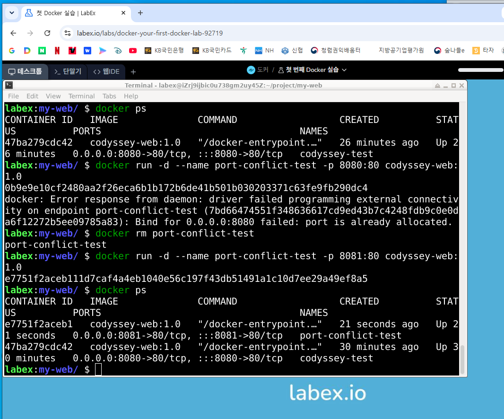

### 11.7 컨테이너 중지

실습을 마친 후 두 번째 컨테이너를 중지했습니다.

```bash
docker stop port-conflict-test
```

`docker stop`은 컨테이너 실행을 중지하는 명령어이며, 컨테이너 자체를 삭제하지는 않습니다.

### 11.8 문제 해결 과정 요약

**문제:** 동일한 호스트 포트 8080을 두 컨테이너가 사용하려고 함

**원인:** 호스트 IP와 포트 조합의 중복 사용

**진단:** `docker ps`로 기존 포트 사용자 확인

**해결:** 새 컨테이너의 호스트 포트를 8081로 변경

**검증:** `docker ps`에서 두 컨테이너가 모두 `Up` 상태인지 확인

이번 실습을 통해 오류 메시지 확인, 원인 분석, 설정 변경, 결과 검증의 순서로 문제를 해결했습니다.


## 12. Git 및 GitHub 실습

### 12.1 Git과 GitHub의 차이

- **Git**: 파일의 변경 이력을 기록하고 관리하는 버전 관리 도구
- **GitHub**: Git 저장소를 온라인에서 보관하고 공유하는 서비스
- **VS Code**: 파일 편집과 Git 명령어 실행에 사용하는 개발 도구

이번 실습에서는 VS Code에서 PowerShell 터미널을 열어 Git 명령어를 실행했습니다.

### 12.2 Git 설치 및 버전 확인

```powershell
git --version
```

실제 확인 결과:

```text
git version 2.56.0.windows.4
```

처음에는 Git 명령어가 인식되지 않았으나 VS Code를 다시 실행한 후 정상적으로 인식됐습니다.

### 12.3 로컬 Git 저장소 초기화

개인 컴퓨터의 작업 폴더:

```text
C:\codyssey-mission
```

먼저 Git 상태를 확인했습니다.

```powershell
git status
```

초기 결과:

```text
fatal: not a git repository
```

현재 폴더가 Git 저장소로 초기화되지 않았기 때문입니다.

다음 명령어를 실행해 저장소를 생성했습니다.

```powershell
git init
```

### 12.4 기존 GitHub 저장소 연결

기존 GitHub 저장소:

https://github.com/haru1208/1029_cs

원격 저장소 주소 등록:

```powershell
git remote add origin https://github.com/haru1208/1029_cs.git
```

등록된 주소 확인:

```powershell
git remote -v
```

확인 결과:

```text
origin  https://github.com/haru1208/1029_cs.git (fetch)
origin  https://github.com/haru1208/1029_cs.git (push)
```

- `fetch`: 원격 저장소의 기록을 가져오는 방향
- `push`: 로컬의 커밋을 원격 저장소로 보내는 방향

### 12.5 기존 GitHub 변경 이력 확인

```powershell
git fetch origin
```

기존 GitHub 저장소의 `main` 브랜치 정보를 가져왔습니다.

이어서 최근 커밋 기록을 확인했습니다.

```powershell
git log origin/main --oneline -5
```

실제 확인한 커밋 기록:

```text
97f65e4 Update README.md
ea193b2 Complete Step 2: File management and archiving
f6d532a Add Step 1: Terminal dir log
b5ee71b Expand README with Git and Docker explanations
15e1475 Add core concepts section to README
```

### 12.6 로컬 Git 브랜치 설정

로컬 브랜치를 확인했습니다.

```powershell
git branch
```

처음에는 아직 로컬 커밋이 없어 브랜치 목록이 표시되지 않았습니다.

이후 `main` 브랜치를 지정했습니다.

```powershell
git symbolic-ref HEAD refs/heads/main
```

기존 원격 저장소의 커밋을 로컬 기록의 기준으로 연결하는 과정도 진행했습니다.

파일 변경 상태를 확인했습니다.

```powershell
git status
```

기존 GitHub 파일이 삭제 예정 상태로 표시되어 다음 명령어로 스테이징 상태를 해제했습니다.

```powershell
git restore --staged .
```

이 명령어는 스테이징 영역의 변경 사항만 해제하며, 작업 폴더의 실제 파일이나 GitHub 파일을 삭제하지 않습니다.

### 12.7 기존 GitHub 커밋 연결 확인

```powershell
git log -1 --oneline
```

실제 확인 결과:

```text
97f65e4 (HEAD -> main, origin/main, origin/HEAD) Update README.md
```

- `HEAD -> main`: 현재 로컬 작업 브랜치
- `origin/main`: GitHub에서 가져온 브랜치
- `97f65e4`: 해당 커밋의 식별 번호

두 브랜치가 동일한 커밋을 가리키는 것을 확인했습니다.

### 12.8 Git의 세 가지 작업 공간

| 구분 | 의미 |
|---|---|
| Working Directory | 파일을 직접 작성하고 수정하는 공간 |
| Staging Area | 다음 커밋에 포함할 변경 사항을 준비하는 공간 |
| Repository | 커밋으로 기록된 변경 이력을 보관하는 공간 |

대표적인 Git 명령어:

- `git status`: 현재 파일 변경 상태 확인
- `git add`: 커밋할 파일을 스테이징 영역에 추가
- `git commit`: 파일 변경 내용을 하나의 기록으로 저장
- `git push`: 로컬 커밋을 GitHub에 업로드
- `git fetch`: 원격 저장소의 변경 기록 가져오기

### 12.9 최종 GitHub 업로드 절차

최종 README와 실습 파일을 모두 확인한 뒤 다음 명령어로 업로드했습니다.

```powershell
git status
git add .
git commit -m "Complete development environment training mission"
git push -u origin main
```

이 명령어로 `accb2af Complete development environment training mission` 커밋을 만들어 GitHub에 올렸습니다.
이후 README 체크리스트를 고쳐 다시 업로드한 결과는 12.10에 기록했습니다.

### 12.10 실습 결과

Git 설치부터 로컬 저장소 초기화, GitHub 원격 저장소 등록, 기존 변경 이력 가져오기, 브랜치 및 커밋 확인까지 완료했습니다.

기존 GitHub 저장소의 커밋 기록을 보존하면서 새 과제 파일을 업로드할 준비를 진행했습니다.

README 체크리스트 수정 후 추가로 실행한 명령어:

```powershell
git push
```

실제 성공 출력:

```text
To https://github.com/haru1208/1029_cs.git
   accb2af..725be94  main -> main
```

최종 업로드 커밋: `725be94`

GitHub 커밋 확인:
https://github.com/haru1208/1029_cs/commit/725be94

`main -> main` 출력으로 로컬 커밋이 GitHub 원격 저장소에 정상적으로 업로드됐음을 확인했습니다.


## 13. 프로젝트 폴더 구조 및 재현 방법

### 13.1 최종 프로젝트 폴더 구조

Windows 작업 폴더 `C:\codyssey-mission`의 주요 파일은 다음과 같습니다.

```text
codyssey-mission/
├── README.md
├── terminal_log.txt
├── archive/
│   └── my_log.txt
├── my-web/
│   ├── Dockerfile
│   └── index.html
├── codyssey-backup.tar.gz
└── screenshots/
    ├── linux-file-permission-644.png
    ├── linux-directory-permission-700-755.png
    ├── docker-info-1.png
    ├── docker-info-2.png
    ├── docker-hello-world.png
    ├── docker-ps-all.png
    ├── docker-images.png
    ├── dockerfile-content.png
    ├── docker-build-success.png
    ├── docker-custom-web-running.png
    ├── docker-custom-web-curl.png
    ├── docker-volume-list.png
    ├── docker-volume-persistence.png
    ├── docker-bind-mount-success.png
    ├── docker-volume-backup-contents.png
    ├── docker-port-conflict.png
    └── docker-port-conflict-solved.png
```

각 폴더와 파일의 역할은 다음과 같습니다.

| 경로 | 역할 |
|---|---|
| `README.md` | 실습 과정과 결과 설명 |
| `terminal_log.txt` | Windows CMD 실습 기록 |
| `archive/my_log.txt` | 복사·이동 실습 결과 |
| `my-web/Dockerfile` | 사용자 지정 Docker 이미지 생성 설정 |
| `my-web/index.html` | Docker 웹 서버에서 제공하는 페이지 |
| `codyssey-backup.tar.gz` | Docker 볼륨 데이터 백업 |
| `screenshots/` | 실습 성공 및 오류 해결 증거 이미지 |

### 13.2 Docker 웹 서버 재현 방법

Docker가 설치되고 실행 중인 Linux 환경에서 다음 명령어를 사용합니다.

저장소 다운로드:

```bash
git clone https://github.com/haru1208/1029_cs.git
cd 1029_cs/my-web
```

Docker 이미지 빌드:

```bash
docker build -t codyssey-web:1.0 .
```

컨테이너 실행:

```bash
docker run -d --name codyssey-test -p 8080:80 codyssey-web:1.0
```

실행 상태 및 웹페이지 확인:

```bash
docker ps
curl http://localhost:8080
```

기대하는 웹페이지 출력:

```text
Hello Codyssey! My First Docker Web Server
```

**참고:** 위 절차는 GitHub에 최종 파일이 업로드된 후 다른 환경에서 따라 할 수 있도록 정리한 것입니다. 다른 환경에서는 기본 이미지 다운로드를 위한 네트워크 연결이 필요할 수 있습니다.

### 13.3 Docker 볼륨 실습 재현 방법

볼륨 생성:

```bash
docker volume create codyssey-data
```

데이터 저장:

```bash
docker run --rm -v codyssey-data:/data docker/getting-started sh -c 'echo "Codyssey volume test" > /data/test.txt'
```

새 컨테이너에서 데이터 확인:

```bash
docker run --rm -v codyssey-data:/data docker/getting-started cat /data/test.txt
```

기대 출력:

```text
Codyssey volume test
```

이 절차로 임시 컨테이너가 삭제돼도 볼륨 데이터가 유지되는지 확인할 수 있습니다.

### 13.4 정리

파일은 역할별 폴더에 분리해 관리했습니다.

명령어, 실행 결과, 스크린샷, Dockerfile을 함께 보관하여 실습 과정을 확인하고 웹 서버를 재현할 수 있도록 구성했습니다.


## 14. 최종 점검 및 실습 정리

### 14.1 실습 완료 항목

이번 개발 환경 구축 실습에서 다음 작업을 수행했습니다.

- [x] Windows CMD 기본 명령어 실행
- [x] 파일 생성, 복사, 이동, 삭제 및 결과 확인
- [x] 절대 경로와 상대 경로의 차이 이해
- [x] Linux 파일 및 디렉터리 권한 실습
- [x] `chmod 644`, `chmod 700`, `chmod 755` 확인
- [x] Docker 버전과 데몬 상태 확인
- [x] `hello-world` 컨테이너 실행
- [x] Docker 이미지와 컨테이너 목록 조회
- [x] Dockerfile 작성 및 사용자 지정 이미지 빌드
- [x] 웹 서버 실행과 포트 매핑 검증
- [x] Docker 볼륨 생성 및 데이터 영속성 확인
- [x] Docker 볼륨 데이터 백업
- [x] 바인드 마운트 및 파일 변경 확인
- [x] Docker 포트 충돌 원인 분석 및 해결
- [x] VS Code와 Git 설치 및 GitHub 저장소 연결
- [x] README 작성 및 실습 증거 정리
- [x] 최종 Git 커밋 및 GitHub 업로드
- [x] 코디세이 AI 재평가 결과 확인 (18/18 PASS, 100%)

### 14.2 문제 해결을 통해 배운 점

Docker 이미지 다운로드 시간 초과와 포트 충돌 문제를 경험했습니다.

오류가 발생했을 때 다음 순서로 해결하는 것이 중요하다는 점을 배웠습니다.

1. 오류 메시지 확인
2. 현재 실행 상태 및 환경 조사
3. 원인에 따른 설정 변경
4. 명령어 재실행
5. 정상 동작 여부 검증


### 14.3 실습 소감

이번 실습을 통해 명령어를 단순히 실행하는 것에서 나아가 파일 관리, Linux 권한, Docker 이미지 및 컨테이너, 데이터 저장 방식, Git 버전 관리의 기본 흐름을 익혔습니다.

특히 Dockerfile을 직접 작성하고 웹 서버를 실행했으며, 발생한 오류를 해결하고 그 과정을 기록한 점이 의미 있었습니다.

앞으로도 실습 결과를 명령어, 출력 결과, 스크린샷과 함께 관리하여 다른 환경에서도 과정을 확인할 수 있도록 하겠습니다.

---
## 추가 보완사항 

### VSCode와 GitHub 연동 확인

새 컴퓨터에서 GitHub 저장소를 clone한 뒤 VSCode로 폴더를 열었습니다.

- 저장소 주소: https://github.com/haru1208/1029_cs.git
- clone 위치: C:\Users\User\Desktop\cs-work\1029_cs
- VSCode에서 저장소 폴더 열기 완료
- VSCode Source Control 기능을 통해 Git 변경 사항 확인 가능
- GitHub 계정 연동 상태에서 저장소 작업 가능

### 확인한 명령어

```powershell
git clone https://github.com/haru1208/1029_cs.git
cd 1029_cs
code .
```

위 과정을 통해 새 컴퓨터에서도 GitHub 저장소를 정상적으로 불러오고 VSCode와 연결할 수 있음을 확인했습니다.

연동 확인 스크린샷:

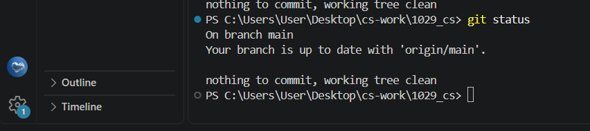

**프로젝트 저장소:** https://github.com/haru1208/1029_cs

